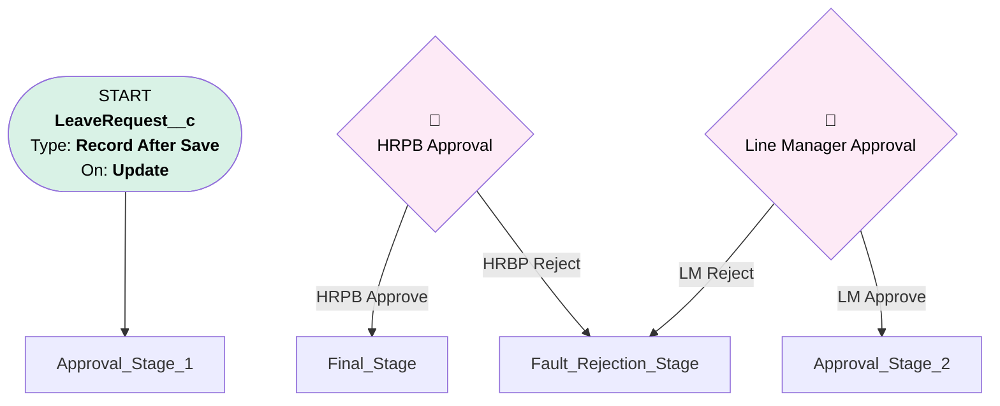

<!-- This file is auto-generated. if you do not want it to be overwritten, set TRUE in the line below -->
<!-- DO_NOT_OVERWRITE_DOC=FALSE -->

# Minlopro - Leave Request - Two Stage Approval

## Flow Diagram

<!-- Flow description -->

## General Information

|<!-- -->|<!-- -->|
|:---|:---|
|Object|LeaveRequest__c|
|Process Type|Approval Workflow|
|Trigger Type|Record After Save|
|Record Trigger Type|Update|
|Label|Minlopro - Leave Request - Two Stage Approval|
|Status|Active|
|Does Require Record Changed To Meet Criteria|✅|
|Description|Multi-stage approval flow to handle leave requests.|
|Environments|Default|
|Interview Label|Minlopro_LeaveRequest_ApprovalProcess {!$Flow.CurrentDateTime}|
|Run In Mode|System Mode Without Sharing|
|BuilderType (PM)|LightningFlowBuilder|
|CanvasMode (PM)|AUTO_LAYOUT_CANVAS|
|OriginBuilderType (PM)|LightningFlowBuilder|
|Connector|Approval_Stage_1|
|Next Node|Approval_Stage_1|

#### Filters (logic: **and**)

|Filter Id|Field|Operator|Value|
|:-- |:-- |:--:|:--: |
|1|Status__c|Equal To|New|

## Formulas

|Name|Data Type|Expression|Description|
|:-- |:--:|:-- |:--  |
|faultOrRejectionMessage|String|IF(ISBLANK({!$Flow.FaultMessage}), 'LM approval decision = ' + {!LM_Approval.Outputs.approvalDecision} + ' | HRBP approval decision = ' + {!HRBP_Approval.Outputs.approvalDecision}, {!$Flow.FaultMessage})|<!-- -->|

## Flow Nodes Details

### HRPB_Approval

|<!-- -->|<!-- -->|
|:---|:---|
|Type|Decision|
|Label|HRPB Approval|
|Default Connector|isGoTo: true targetReference: Fault_Rejection_Stage |
|Default Connector Label|HRBP Reject|

#### Rule HRPB_Approve (HRPB Approve)

|<!-- -->|<!-- -->|
|:---|:---|
|Connector|Final_Stage|
|Condition Logic|and|

|Condition Id|Left Value Reference|Operator|Right Value|
|:-- |:-- |:--:|:--: |
|1|HRBP_Approval.Outputs.approvalDecision|Equal To|Approve|

### LineManagerApproval

|<!-- -->|<!-- -->|
|:---|:---|
|Type|Decision|
|Label|Line Manager Approval|
|Default Connector|isGoTo: true targetReference: Fault_Rejection_Stage |
|Default Connector Label|LM Reject|

#### Rule LM_Approv (LM Approve)

|<!-- -->|<!-- -->|
|:---|:---|
|Connector|Approval_Stage_2|
|Condition Logic|and|

|Condition Id|Left Value Reference|Operator|Right Value|
|:-- |:-- |:--:|:--: |
|1|LM_Approval.Outputs.approvalDecision|Equal To|Approve|

___

_Documentation generated from branch develop by [sfdx-hardis](https://sfdx-hardis.cloudity.com), featuring [salesforce-flow-visualiser](https://github.com/toddhalfpenny/salesforce-flow-visualiser)_