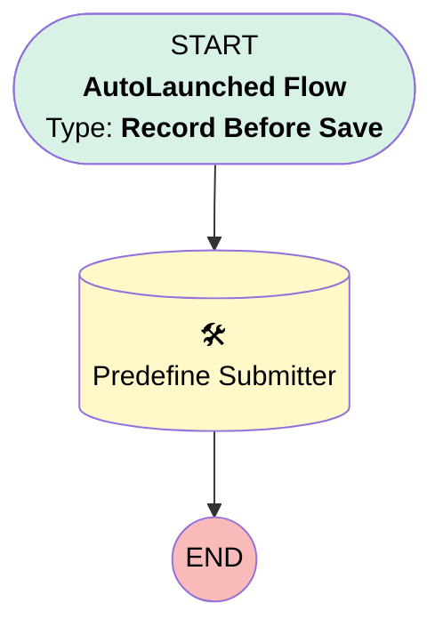

<!-- This file is auto-generated. if you do not want it to be overwritten, set TRUE in the line below -->
<!-- DO_NOT_OVERWRITE_DOC=FALSE -->

# Minlopro - Leave Request - Predefine Submitter

## Flow Diagram

<!-- Flow description -->

## General Information

|<!-- -->|<!-- -->|
|:---|:---|
|Object|LeaveRequest__c|
|Process Type|Auto Launched Flow|
|Trigger Type|Record Before Save|
|Record Trigger Type|Create|
|Label|Minlopro - Leave Request - Predefine Submitter|
|Status|Active|
|Description|Pre-populate 'Submitter' with running user ID when the field is blank.|
|Environments|Default|
|Interview Label|Minlopro - Leave Request - Prepopulated Submitter {!$Flow.CurrentDateTime}|
|BuilderType (PM)|LightningFlowBuilder|
|CanvasMode (PM)|AUTO_LAYOUT_CANVAS|
|OriginBuilderType (PM)|LightningFlowBuilder|
|Connector|[Predefine_Submitter](#predefine_submitter)|
|Next Node|[Predefine_Submitter](#predefine_submitter)|

#### Filters (logic: **and**)

|Filter Id|Field|Operator|Value|
|:-- |:-- |:--:|:--: |
|1|Submitter__c|Is Null|True|

## Flow Nodes Details

### Predefine_Submitter

|<!-- -->|<!-- -->|
|:---|:---|
|Type|Record Update|
|Label|Predefine Submitter|
|Input Reference|$Record|

#### Input Assignments

|Field|Value|
|:-- |:--: |
|Submitter__c|$User.Id|

___

_Documentation generated from branch develop by [sfdx-hardis](https://sfdx-hardis.cloudity.com), featuring [salesforce-flow-visualiser](https://github.com/toddhalfpenny/salesforce-flow-visualiser)_