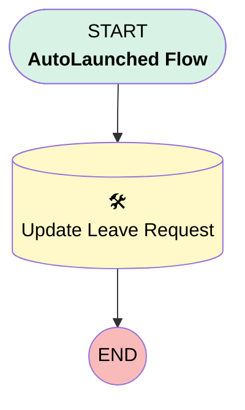

<!-- This file is auto-generated. if you do not want it to be overwritten, set TRUE in the line below -->
<!-- DO_NOT_OVERWRITE_DOC=FALSE -->

# Minlopro - Leave Request - Update Record

## Flow Diagram

<!-- Flow description -->

## General Information

|<!-- -->|<!-- -->|
|:---|:---|
|Process Type|Auto Launched Flow|
|Label|Minlopro - Leave Request - Update Record|
|Status|Active|
|Description|Utility flow referenced in Flow Approval Process.|
|Environments|Default|
|Interview Label|Minlopro - Leave Request - Update Record {!$Flow.CurrentDateTime}|
|BuilderType (PM)|LightningFlowBuilder|
|CanvasMode (PM)|AUTO_LAYOUT_CANVAS|
|OriginBuilderType (PM)|LightningFlowBuilder|
|Connector|[Update_Leave_Request](#update_leave_request)|
|Next Node|[Update_Leave_Request](#update_leave_request)|

## Variables

|Name|Data Type|Is Collection|Is Input|Is Output|Object Type|Description|
|:-- |:--:|:--:|:--:|:--:|:--:|:--  |
|recordId|String|⬜|✅|⬜|<!-- -->|Leave Request record ID.|
|status|String|⬜|✅|⬜|<!-- -->|Value to apply for Leave Request record 'Status' field.|
|statusComment|String|⬜|✅|⬜|<!-- -->|Value to apply for Leave Request record 'Status Comment' field.|

## Flow Nodes Details

### Update_Leave_Request

|<!-- -->|<!-- -->|
|:---|:---|
|Type|Record Update|
|Object|LeaveRequest__c|
|Label|Update Leave Request|

#### Filters (logic: **and**)

|Filter Id|Field|Operator|Value|
|:-- |:-- |:--:|:--: |
|1|Id|Equal To|recordId|

#### Input Assignments

|Field|Value|
|:-- |:--: |
|StatusComment__c|statusComment|
|Status__c|[status](#status)|

___

_Documentation generated from branch develop by [sfdx-hardis](https://sfdx-hardis.cloudity.com), featuring [salesforce-flow-visualiser](https://github.com/toddhalfpenny/salesforce-flow-visualiser)_