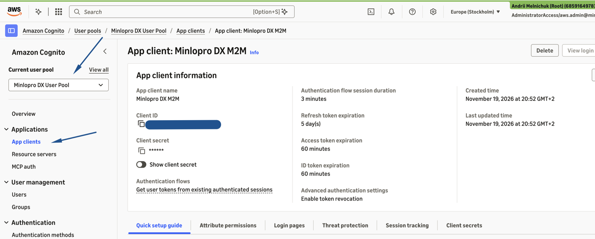
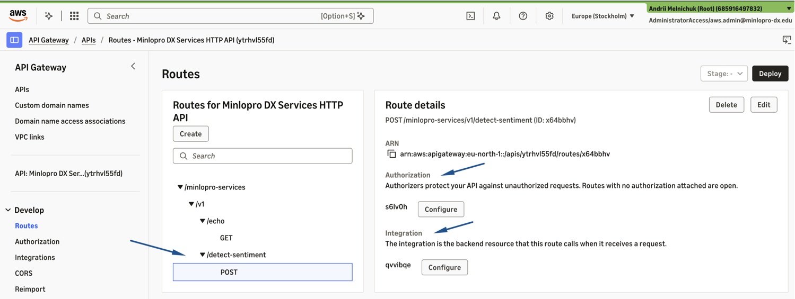
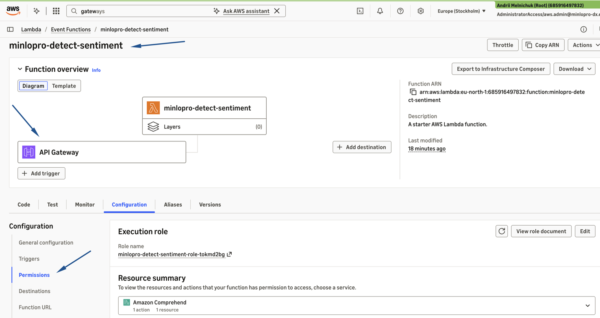
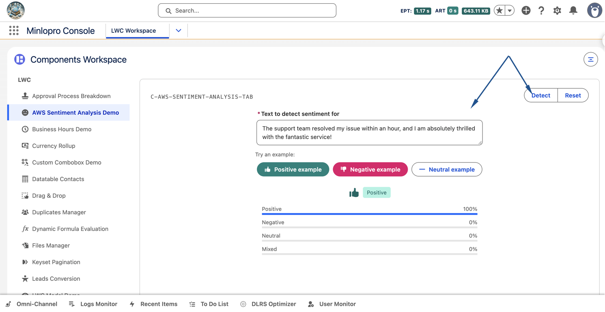

# ☁️ Sentiment Detection (AWS Integration)

Hands-on learning project: a Salesforce user submits free text from a custom LWC tab and gets
back a detected sentiment, computed by an AWS Lambda via Amazon Comprehend.

This package hosts both the Salesforce metadata (`main/`) and the AWS Lambda code
(`aws-lambdas/<function>/`) for this exercise, so it's self-contained and easy to remove later.

## 🧭 Integration flow

```
Amazon Cognito (User Pool, client_credentials app client) ──issues──► access token
                                                                              │
Salesforce: LWC ──Apex callout (Named Credential, Bearer token)──► API Gateway (HTTP API, JWT authorizer)
                                                                              │
                                                      Lambda (Python) ─► Comprehend DetectSentiment
Salesforce ◄──────────────── synchronous HTTP response (sentiment + score) ◄─┘
```

- **Amazon Cognito** — User Pool with an app client on the OAuth 2.0 `client_credentials` grant
  (machine-to-machine; no signed-in user, no ID token — only an access token).
- **API Gateway (HTTP API)** — native **JWT authorizer** validates the access token (issuer =
  User Pool issuer URL, audience = app client ID) before invoking the Lambda.
- **AWS Lambda** (`minlopro-detect-sentiment`, Python 3.13) — validates the `text` field
  (20–300 chars), calls Comprehend, returns the result.
- **Amazon Comprehend** — `DetectSentiment`, pinned to `eu-central-1` (not offered in every
  region, including `eu-north-1` where the Lambda itself runs).
- No AWS IAM users/access keys anywhere — Lambdas use execution roles, the Salesforce↔AWS hop
  uses the Cognito token above instead of SigV4.

## 📸 Screenshots

|                                                                                                                           |
| ------------------------------------------------------------------------------------------------------------------------- |
| **Cognito User Pool (client_credentials app client)**                                                                     |
|              |
| **API Gateway (HTTP API, JWT authorizer)**                                                                                |
|        |
| **Lambda execution role permissions**                                                                                     |
|  |
| **Sentiment detection in the LWC**                                                                                        |
|                                  |

## 💻 Common AWS CLI commands

All of these pass `--profile minlopro-admin` explicitly — don't rely on `$AWS_PROFILE`.

```bash
# SSO login / identity check
aws sso login --profile minlopro-admin
aws sts get-caller-identity --profile minlopro-admin

# Invoke a Lambda directly
aws lambda invoke \
  --function-name <function-name> \
  --payload '{"text":"..."}' \
  --cli-binary-format raw-in-base64-out \
  --profile minlopro-admin \
  build/lambda/<function-name>/response.json

# Redeploy a Lambda's code (stages/zips/deploys/cleans up under build/)
bash ./src/minlopro-aws-cloud-computing/scripts/deploy_lambda_code.sh \
  "<function-name>" "src/minlopro-aws-cloud-computing/aws-lambdas/<function-name>"
```

Local Python tooling (`pip3 install -r requirements-dev.txt` once):

```bash
npm run python:test          # pytest across every aws-lambdas/<function>/
npm run python:lint:fix      # ruff check --fix
npm run python:format        # ruff format
```

## ⚠️ Notes / Gaps Found

- **Comprehend is region-limited** (not in `eu-north-1`). `boto3.client(...)` with no
  `region_name` silently inherits the Lambda's own region — pin it explicitly. A Lambda can call
  another region fine; only cost is latency.
- **Lambdas run as an execution role, not a user.** The console only grants CloudWatch Logs
  permissions by default — any other AWS API the code calls needs its own permission added to
  that same role.
- **`comprehend:DetectSentiment` requires `Resource: "*"`** (AWS has no resource-level
  permissions for it) — still scope the _action_ narrowly instead of attaching a broad managed
  policy like `ComprehendReadOnly`.
- **API Gateway's proxy integration nests the body as a JSON string** under `event["body"]` —
  unwrap it. A flat `event.get("text")` only works from the console's Test tab, not real traffic.
- **REST API's native Cognito authorizer validates ID tokens only.** `client_credentials` is
  machine-to-machine (no signed-in user), so Cognito never issues an ID token for it — every
  request 401s regardless of token validity, and it's not an IAM/role problem at all. Fix: use an
  **HTTP API** with its native **JWT authorizer**, which accepts access tokens directly.
- **HTTP API's Lambda integration is always proxy-style, no passthrough.** The function must
  return exactly `{"statusCode": ..., "body": "<JSON string>", "headers": {...}}` — flat
  top-level keys instead of a `body` string get the right `statusCode` with a silently **empty**
  response body, no error anywhere.
