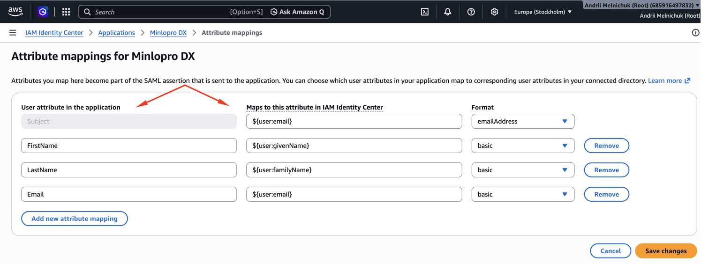
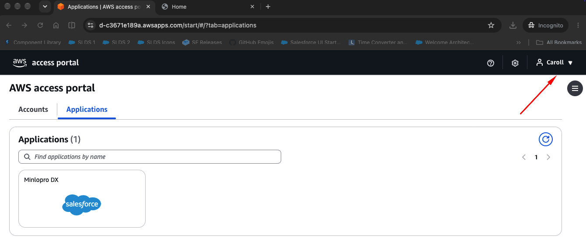
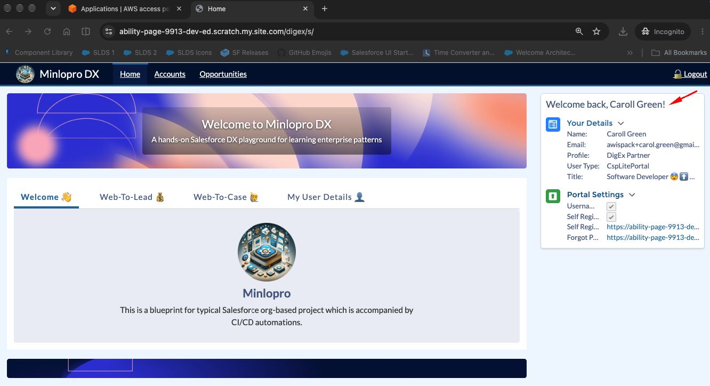
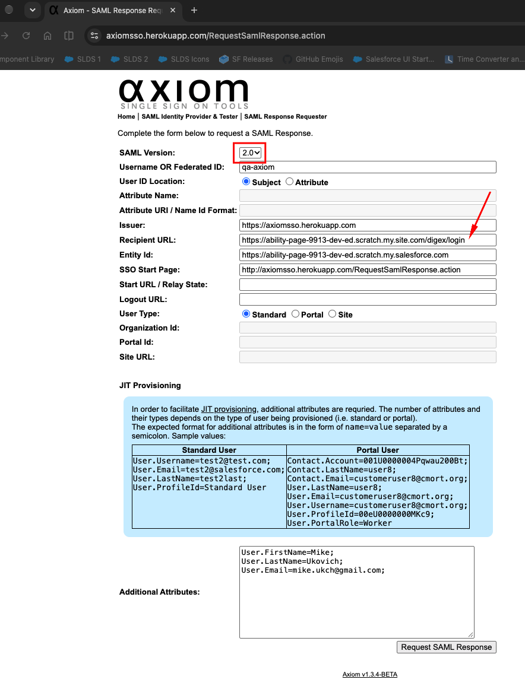

# 🔐 Single Sign-On (SSO)

Metadata for authenticating users into this org via an external Identity Provider (IdP) using
SAML, with Just-In-Time (JIT) provisioning of both standard and Experience Site (portal) users.

## 🤔 What is SSO?

**Delegated authentication** — in two words, "one login": a user authenticates once with a
trusted external system, and that system vouches for them to Salesforce, instead of Salesforce
owning the credential itself.

### Terminology

- **IdP (Identity Provider)** — the system that authenticates the user and issues a signed
  assertion about who they are (e.g. Axiom, AWS IAM Identity Center).
- **SP (Service Provider)** — the system that trusts the IdP and consumes the assertion to log
  the user in. Salesforce is the SP here.
- **SAML (Security Assertion Markup Language)** — the XML-based protocol used to exchange
  authentication/authorization data between IdP and SP.
- **Assertion** — the signed XML payload the IdP issues, containing the authenticated user's
  identity and any additional attributes.
- **Federation ID / Identity Location / Identity Mapping** — how Salesforce resolves the SAML
  Subject in the assertion to a specific `User` record (see `SamlSsoConfig.identityLocation` /
  `identityMapping`).
- **JIT (Just-In-Time) Provisioning** — creating or updating a Salesforce `User` automatically at
  login time, driven by attributes in the SAML assertion, instead of pre-provisioning users
  up front. Implemented here via `Auth.SamlJitHandler`.
- **SP-initiated vs. IdP-initiated** — whether the login flow starts at Salesforce (user hits a
  Salesforce/Experience Site login page and gets redirected to the IdP) or at the IdP (user logs
  into the IdP's portal first and is pushed into Salesforce).

This org has two `SamlSsoConfig`s configured: **Axiom Test App**, used purely for local testing
(see below), and **AWS IAM Identity Center**, kept as a second, more realistic enterprise IdP
example.

## 🧪 Debugging with Axiom

[Axiom](https://axiomsso.herokuapp.com/Home.action) is a free SAML IdP simulator — it lets you
hand-craft a SAML assertion (issuer, recipient, attributes, JIT fields) and send it to Salesforce
without needing a real IdP. It's configured as the `Axiom Test App` SamlSsoConfig plus a matching
Remote Site Setting in this package.

Salesforce's own Trailhead module on SSO (uses Axiom in its walkthroughs) is a good companion:
[Single Sign-On (Trailhead)](https://trailhead.salesforce.com/content/learn/modules/identity_login/identity_login_sso?trailmix_creator_id=patmburke&trailmix_slug=single-sign-on).

## ☁️ Using AWS IAM Identity Center as IdP

Notes specific to wiring up **AWS IAM Identity Center** (vs. the Axiom test tool) as the IdP for
this org's JIT handler:

- 🎯 When configuring AWS IAM Identity Center as the IdP for a JIT handler that creates a
  **portal user**, make sure to put the Experience Site login URL into the **Application ACS
  URL** on the AWS side. Otherwise the process fails on the Salesforce side — this is due to the
  nature of the resulting user, which has a portal license.
- 🧩 On the AWS side, make sure to configure **attribute mappings** on the application's details
  page, and align them with the mandatory attributes mandated by the JIT handler implementation
  (see below).
- 🔑 Users provisioned via AWS IAM Identity Center are expected to log in through the **AWS
  access portal**, not directly via a Salesforce/Experience Site login page. Its URL can be found
  in the AWS console (IAM Identity Center → Settings → Identity source → AWS access portal URL).

|                                                                                                   |
| ------------------------------------------------------------------------------------------------- |
| **Attribute Mappings**                                                                            |
|      |
| **AWS Access Portal**                                                                             |
|      |
| **Logged Into DigEx**                                                                             |
|  |

## ⚠️ Notes / Gaps Found

### 🧭 Recipient URL must target the Experience Site for portal JIT provisioning

When the JIT handler is expected to provision a **portal (Experience Site) user** at runtime, the
**Recipient URL** field in the SAML assertion must point at the Experience Site's own login
endpoint — not the org's base My Domain URL. Pointing it at the base domain results in the
assertion never reaching the portal context, so no portal user gets created.

### 🧷 Mandatory attributes are controlled at the JIT handler level, not in the SAML config

Which assertion attributes are treated as required is a decision made inside the JIT handler
itself, not declared anywhere in `SamlSsoConfig` metadata. See
`MinloproSamlJitHandler.DigExPartnerUserBuilder.validate()`, which throws if `FirstName`,
`LastName`, or `Email` weren't resolved from the incoming attributes — so changing what's
mandatory means editing the handler, not the SSO config.

### 🚫 Emojis in the SAML assertion silently break the transaction

When using **AWS IAM Identity Center** as the IdP and a Salesforce **Experience Site** as the SP,
the SAML assertion markup must not contain emoji characters anywhere in its XML (e.g. in an
attribute value). If it does, the login transaction fails on the Salesforce side — but the
failure is **not** surfaced in debug logs, making the root cause effectively invisible from the
Salesforce side alone.

This was identified empirically using the Axiom IdP simulator combined with manual SAML markup
generation — by hand-crafting assertions with and without emoji content and comparing outcomes.
If an SSO transaction is failing with no corresponding error in debug logs, check the assertion
payload for emoji characters before investigating further.
