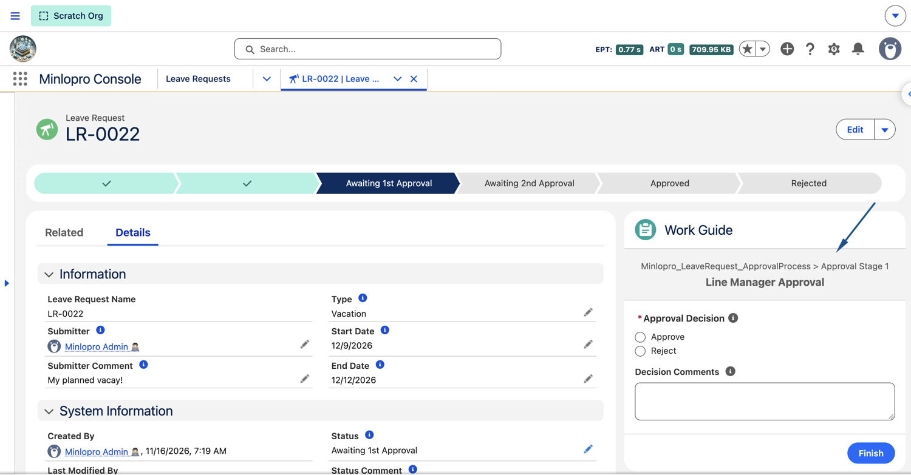
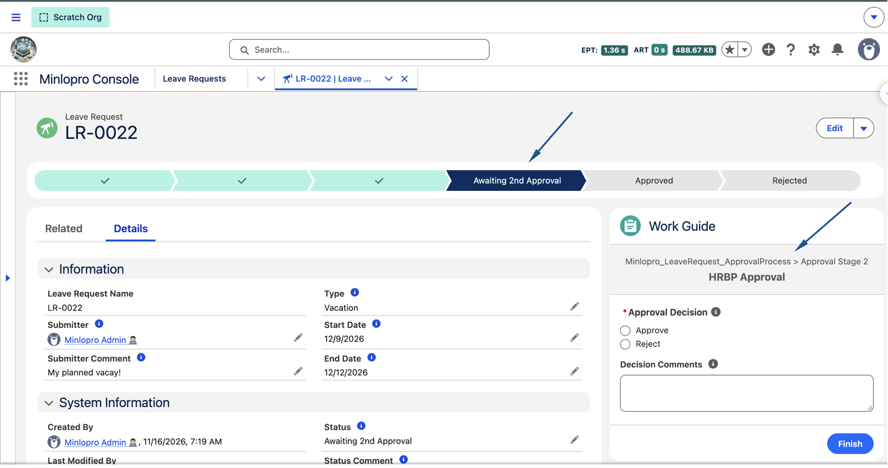

# ⚙️ Flow Approval Process (POC)

A small, self-contained POC built around a `LeaveRequest__c` custom object, used to explore the
**Flow Approval Process** flow type — the modern, Flow-based replacement for classic Approval
Processes.

Inspired by [Salesforce Approvals in Flow Builder (YouTube)](https://www.youtube.com/watch?v=SezLqa1-RIU).

## 🤔 What is a Flow Approval Process?

A flow with `processType = ApprovalWorkflow` — an **orchestration** (same engine as Flow
Orchestration: stages + steps) that natively understands approvals. Instead of declaring approval
steps, approvers and field updates in the rigid classic Approval Process setup screens, the whole
approval lifecycle is authored in Flow Builder.

Notable advantages over the classic Approval Process: reusable actions/subflows in between
approval steps, parallel and conditional steps, fault handling, and everything versioned as a
single Flow metadata file.

## 🎯 Use Case

Replicate a typical HR **two-stage leave request approval**: Stage 1 goes to a **specific user**
(the Line Manager), Stage 2 goes to the **`HRBPs` public group** — of which that same user is
also a member, which is what makes the two UI variations below comparable side by side. Either
rejection (or any fault) routes to a shared Fault/Rejection stage.

|                                                                                                                                  |
| -------------------------------------------------------------------------------------------------------------------------------- |
| **Stage 1 — assigned to a specific User**                                                                                        |
|  |
| **Stage 2 — assigned to a Public Group**                                                                                         |
|   |

## ⚠️ Notes / Gaps Found

- The approval step assignee is **hard-coded metadata**, so the Line Manager assignee is injected
  at deploy time through the `${SF_ADMIN_USERNAME}` `replacements` entry in `sfdx-project.json`
  (see `.env`) rather than being resolved dynamically from the submitter's manager.
- The orchestration runs in `SystemModeWithoutSharing`, which is why the background steps can
  update a record that the approval steps have locked.
